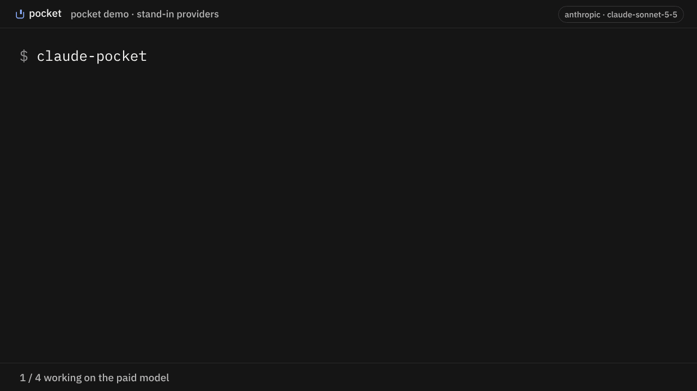
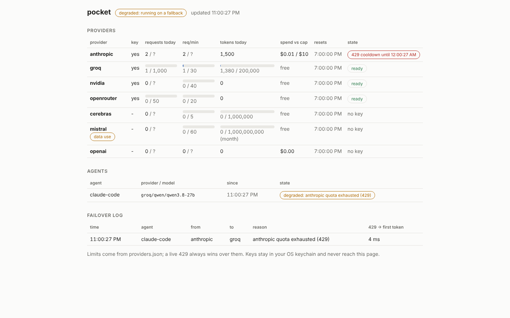

<p align="center">
  <picture>
    <source media="(prefers-color-scheme: dark)" srcset="docs/brand/reveal-on-dark.gif">
    
  </picture>
</p>
<p align="center"><b>When your coding agent hits its usage limit, pocket moves it to your next key.</b></p>
<p align="center">Your own keys, in your OS keychain. Runs on your machine. Every switch names the model now answering.</p>

<p align="center">
  <a href="https://www.npmjs.com/package/@zerwone/pocket"></a>
  <a href="https://github.com/zerwone/pocket/actions/workflows/test.yml"></a>
  
  
  <a href="LICENSE"></a>
</p>
<p align="center">
  <a href="https://zerwone.github.io/pocket/">Website</a> ·
  <a href="https://www.npmjs.com/package/@zerwone/pocket">npm</a> ·
  <a href="https://github.com/zerwone/pocket/releases">Releases</a> ·
  <a href="docs/REFERENCE.md">Reference</a>
</p>

**pocket is a free, open-source command-line tool that keeps Claude Code and Codex working when they hit a usage limit or rate limit (HTTP 429).** It runs a small router on your own machine. When your current provider refuses a request for quota, it resends it to the next API key you configured (Groq, NVIDIA, OpenRouter, Cerebras, or your Anthropic or OpenAI key) and tells you which model is now answering.

<p align="center"></p>
<p align="center"><sub>Stand-in providers; the limit is simulated. The switch notice and log lines are pocket's real output.</sub></p>

---

## How it works

```
claude-pocket ──► pocket (127.0.0.1:3460, on your machine)
                    │
                    ├─► 1. your Anthropic / OpenAI key   ← first, if you have one
                    │      429 "usage limit"? ──┐
                    ├─► 2. Groq        (free)  ◄┘  next key with quota left
                    ├─► 3. NVIDIA      (free)
                    ├─► 4. OpenRouter  (free)
                    └─► 5. Cerebras    (free)
```

1. You start your agent through pocket (`claude-pocket` instead of `claude`). It looks and works exactly the same.
2. Every request goes to pocket first, which sends it to the first key in your order that has quota left.
3. When that key answers "limit reached" (HTTP 429), pocket sends the **same request** to the next key, in the middle of the session, without a restart.
4. The next reply starts with one line saying which model is answering now, so you always know.
5. pocket reads each provider's live model list, so it picks models that exist for your key today and skips retired ones on its own.

## Requirements

- **Node.js 20 or newer** ([nodejs.org](https://nodejs.org))
- **Claude Code** ([install](https://code.claude.com/docs/en/setup)) and/or **Codex CLI** (`npm i -g @openai/codex`)
- **At least one API key.** Free keys are fine; `pocket setup` links you to each signup page.

## Install

```sh
npm i -g @zerwone/pocket
```

Package: [npmjs.com/package/@zerwone/pocket](https://www.npmjs.com/package/@zerwone/pocket)

> Do not run `npx pocket`. That name on npm belongs to someone else. The package is `@zerwone/pocket`.

## Use it

**1. Set it up once**

```sh
pocket setup
```

It finds Claude Code and Codex on your machine, walks you through free keys from Groq, NVIDIA, OpenRouter and Cerebras (with the signup link for each; skip any you don't want), optionally adds your paid key (used first, up to $10 a day), and connects your agents. A couple of minutes if your keys are ready.

**2. Start your agent through pocket**, from your project folder:

```sh
cd my-project
claude-pocket          # instead of: claude
codex-pocket           # instead of: codex
```

Plain `claude` and `codex` keep working as before; only the `-pocket` commands go through pocket.

**3. Work as usual.** Nothing changes until a key runs out. Then the next reply starts with:

```
[pocket] running on groq/openai/gpt-oss-120b, anthropic quota exhausted (429)
```

and the session carries on, as long as the next key has quota left. The fallback model may handle the task differently or worse, so review what it does. Free keys have limits too; when all of them are spent, the agent stops as it would without pocket.

**4. Check on it any time**

```sh
pocket dash              # quota left on each key, spend today, every switch
pocket models --refresh  # which model each provider will use right now
pocket doctor            # something off? start here
```

<picture>
  <source media="(prefers-color-scheme: dark)" srcset="docs/brand/dashboard-dark.png">
  
</picture>

**5. Undo**

```sh
pocket detach claude     # removes claude-pocket; your config goes back exactly as it was
pocket detach codex
```

### With a Claude Pro or Max plan

`claude-pocket` runs Claude Code on API keys, not on your subscription login. So:

- work with plain `claude` (or the Claude desktop app) on your plan, with Claude's own models
- when the plan hits its limit, run `claude-pocket` in the same project folder and keep going on your keys

Your files are the same; the conversation is not. To hand over cleanly, ask Claude for a short note (what we're building, what's done, what's next) and save it as `CLAUDE.md` in the project. Claude Code reads it when it starts.

## How much free do you get

| Provider | Free per key | Get a key |
| --- | --- | --- |
| Groq | 1,000 requests/day | [console.groq.com/keys](https://console.groq.com/keys) |
| NVIDIA | ~40 requests/min | [build.nvidia.com](https://build.nvidia.com) |
| OpenRouter | 50 requests/day (1,000 after a one-time $10 top-up) | [openrouter.ai/settings/keys](https://openrouter.ai/settings/keys) |
| Cerebras | 1M tokens/day, 5 requests/min | [cloud.cerebras.ai](https://cloud.cerebras.ai) |

Checked against each provider's docs on 2026-11-08. Mistral (1B tokens/month) is supported but off by default, because its free plan may use your requests for training.

## Commands

| Command | What it does |
| --- | --- |
| `pocket setup` | First run, or add more keys later |
| `claude-pocket` / `codex-pocket` | Run Claude Code / Codex through pocket |
| `pocket dash` | Dashboard: quota, spend, switches |
| `pocket models [--refresh]` | Which model each provider will use, from its live list |
| `pocket doctor` | Checks keychain, daemon, every key, attached agents |
| `pocket keys add <provider>` | Add or replace one key |
| `pocket attach claude` / `codex` | Create the launcher (setup does this for you) |
| `pocket detach claude` / `codex` | Undo attach, byte for byte |
| `pocket daemon start` / `stop` / `logs` | The local router (launchers start it for you) |

Full list, routing rules and provider details: [docs/REFERENCE.md](docs/REFERENCE.md)

## How it handles your keys

- **Your keys only.** Each provider only ever sees the key you gave it for that provider. Nothing is pooled or shared. Your requests go to the provider you configured.
- **No pocket account, no telemetry.** You still need an account with each provider.
- **OS keychain, not pocket's config files.** Windows Credential Manager, macOS Keychain, or Secret Service on Linux.
- **Local only.** Listens on `127.0.0.1` and refuses anything without its local token.

More: [docs/SECURITY.md](docs/SECURITY.md)

## Updating

```sh
pocket daemon stop
npm i -g @zerwone/pocket@latest
pocket --version
```

Stop the daemon first: on Windows a running daemon keeps files open and npm can't replace them.

## Troubleshooting

**`'claude' is not recognized` or `pocket: Claude Code is not installed`**
Claude Code itself isn't installed, or isn't on your PATH. Install it from [code.claude.com/docs/en/setup](https://code.claude.com/docs/en/setup), then open a new terminal and check `claude --version`. The Claude desktop app is separate and doesn't install the `claude` command.

**`'claude-pocket' is not recognized`**
Run `pocket detach claude` then `pocket attach claude` with pocket 0.1.3 or newer; the launcher goes next to the `pocket` command, which is already on your PATH.

**`npm warn cleanup ... EPERM` while updating**
The daemon was still running. `pocket daemon stop`, then install again.

**`404 Not Found` installing a version that was just released**
npm takes a few minutes to make a new version downloadable. Wait and try again.

**The agent keeps retrying with a 500 / 400 from pocket**
Run `pocket daemon logs` and look for the `failed:` lines; they show which provider refused and why. Please [open an issue](https://github.com/zerwone/pocket/issues) with those lines (they contain no keys).

**Codex won't start after attaching with pocket 0.1.1**
That version wrote a config Codex no longer accepts. `pocket detach codex`, update pocket, then `pocket attach codex`.

## FAQ

**What can I do when Claude Code says "usage limit reached"?**
Four options: wait for the limit to reset; switch Claude Code to a paid Anthropic API key; route Claude Code through one gateway such as OpenRouter; or run it through pocket, which tries your own keys from several providers in order and switches automatically, mid-session, without restarting.

**How is pocket different from OpenRouter, LiteLLM or claude-code-fallback?**
OpenRouter is one provider and gateway; pocket can use an OpenRouter key as one step in its order. LiteLLM is a general proxy you configure yourself. claude-code-fallback moves you from a Claude subscription to Anthropic API billing only. pocket is narrower: one `pocket setup`, keys in your OS keychain, a quota meter per key, launchers for Claude Code and Codex, and a notice in the session each time it switches.

**Which model answers after a switch?**
The first provider in your order with quota left (by default Groq, then NVIDIA, OpenRouter and Cerebras), and on it the best model its live model list offers your key right now, matched to what the agent asked for. pocket reads each provider's list itself, so a retired or no-longer-free model is skipped automatically. The reply names the provider and model; `pocket models` shows what it will pick.

**Is it free? Is it allowed?**
pocket is MIT-licensed. The free allowance comes from each provider's own free tier on your own account. pocket never pools or shares keys. Read each provider's terms; Mistral's free plan may train on your requests, so it is off by default.

**Does my code leave my machine?**
Your requests go to the provider you configured, the same as using that provider directly. pocket itself has no server, no account and no telemetry.

**Does it work on Windows?**
Yes. Keys go to Windows Credential Manager, the launchers are `.cmd` files, and the test suite runs on Windows, macOS and Linux on every change.

## Works with

**Claude Code** (CLI and VS Code), **Codex CLI**. Cursor partly: chat with your own key only, not Agent or Composer. Not the Claude desktop app or claude.ai, which sign in with your Claude account directly. Windows, macOS, Linux.

---

Built by Mohamad Aljadaan at **ZerwOne**.

MIT · [Contributing](docs/DEVELOPMENT.md) · [Report a bug](https://github.com/zerwone/pocket/issues) · Sister project: [**staked**](https://github.com/zerwone/staked), gives each coding agent its own part of the repo
